# Food Flow 🛒

> Aplikasi Manajemen Penjualan Sistem Konsinyasi untuk UMKM Kuliner.

## 📖 Tentang Projek

Food Flow adalah sistem informasi yang dirancang untuk mempermudah UMKM kuliner dalam mengelola alur bisnis konsinyasi (titip jual). Aplikasi ini membantu pemilik usaha dalam melacak pergerakan stok barang, memantau performa penjualan setiap outlet, dan mengelola pencatatan data secara terpusat dan efisien.

Proyek ini terdiri dari aplikasi desktop berbasis Flutter dan Dashboard Web berbasis PHP untuk mendukung pemantauan serta analisis data penjualan.

## ✨ Fitur Utama

### A. Aplikasi Desktop Food Flow

- **Dashboard Owner:** Visualisasi data ringkas dan grafik performa penjualan bisnis.
- **Manajemen Logistik:** Pelacakan distribusi stok produk antar-outlet dan pencatatan retur barang.
- **Master Data:** Modul pengelolaan (CRUD) data Penjual, Outlet, dan Produk.
- **Sistem Autentikasi:** Login dan Registrasi dengan manajemen hak akses pengguna.
- **Laporan:** Pengelolaan dan pemantauan laporan transaksi.

### B. Dashboard Web FoodFlow

Dashboard Web digunakan untuk memantau ringkasan penjualan dan distribusi produk melalui visualisasi data.

- **Summary Cards:** Menampilkan total produk terjual, total mitra, dan total pendapatan.
- **Database Query:** Mengambil dan mengolah data secara langsung dari database MySQL.
- **Data Filtering:** Penyaringan berdasarkan tanggal awal, tanggal akhir, mitra, dan produk.
- **Bar Chart:** Membandingkan jumlah produk terjual.
- **Line Chart:** Menampilkan perkembangan omzet berdasarkan tanggal.
- **Pie Chart:** Menampilkan kontribusi omzet setiap mitra.
- **Tabel Penjualan:** Menampilkan detail tanggal transaksi, mitra, produk, jumlah terjual, dan omzet.

## 🛠️ Teknologi yang Digunakan

| Komponen | Teknologi |
|---|---|
| Desain UI/UX | Figma |
| Frontend Desktop | Flutter |
| Backend Desktop | FoodFlow API |
| Backend Dashboard Web | PHP |
| Database | MySQL / MariaDB |
| Web Interface | HTML dan CSS |
| Scripting | JavaScript |
| Data Visualization | Chart.js |
| Development Tools | Visual Studio Code |
| Local Server | XAMPP |

## 📸 Pratinjau Antarmuka Aplikasi Desktop

### Dashboard Owner dan Manajemen Logistik

| Dashboard Owner | Manajemen Logistik |
|:---:|:---:|
| 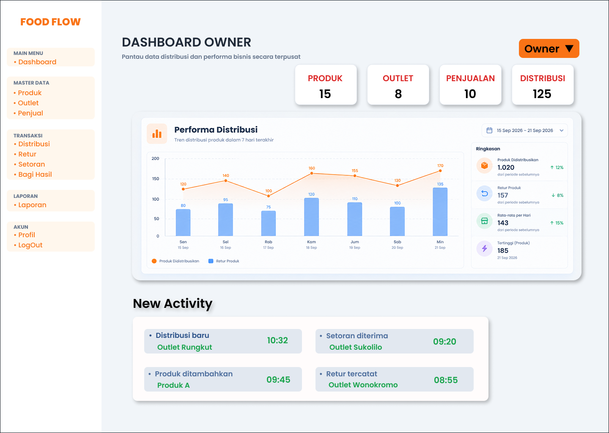 | 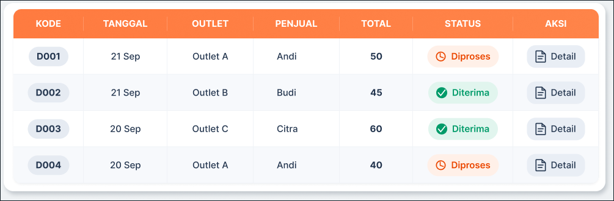 |

### Master Data

| Master Data | Master Produk |
|:---:|:---:|
| 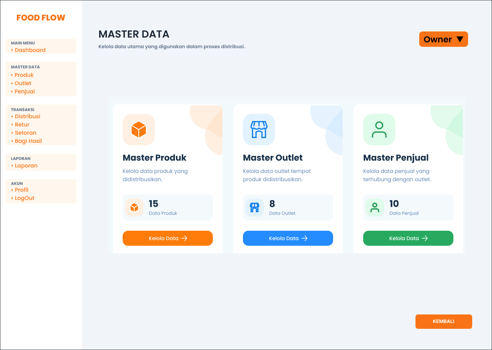 | 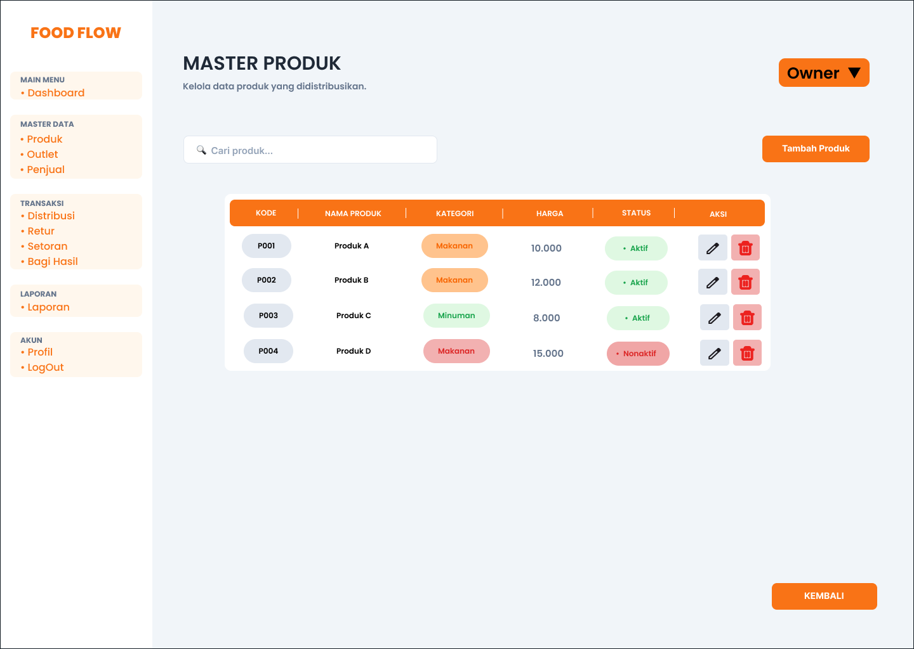 |

### Sistem Autentikasi

| Login | Registrasi |
|:---:|:---:|
| 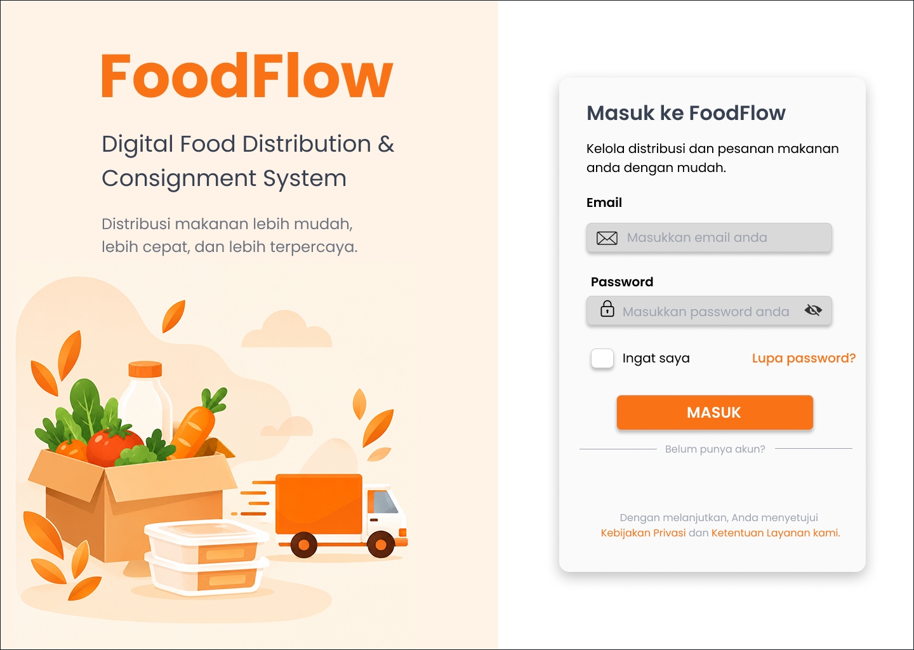 | 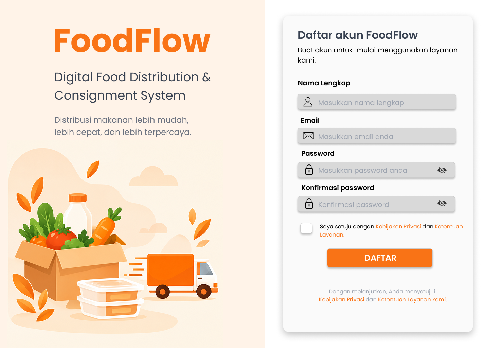 |

### Manajemen Data

| Tambah Produk | Tambah Outlet |
|:---:|:---:|
| 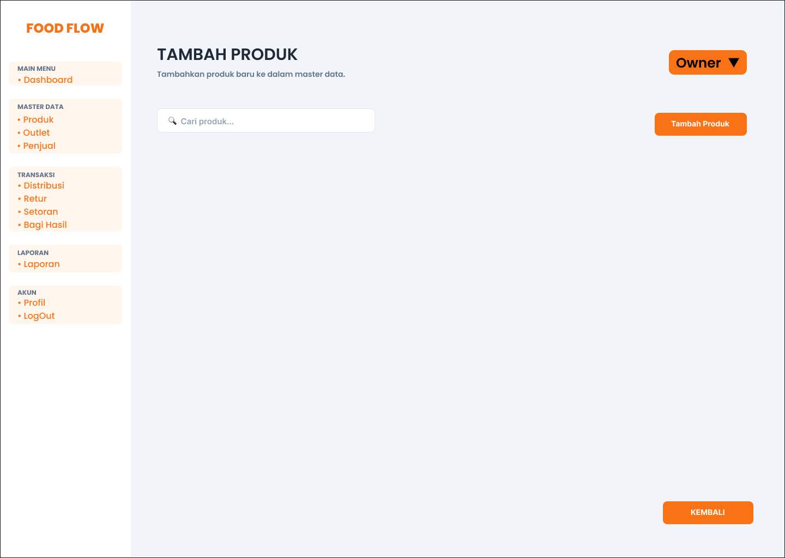 | 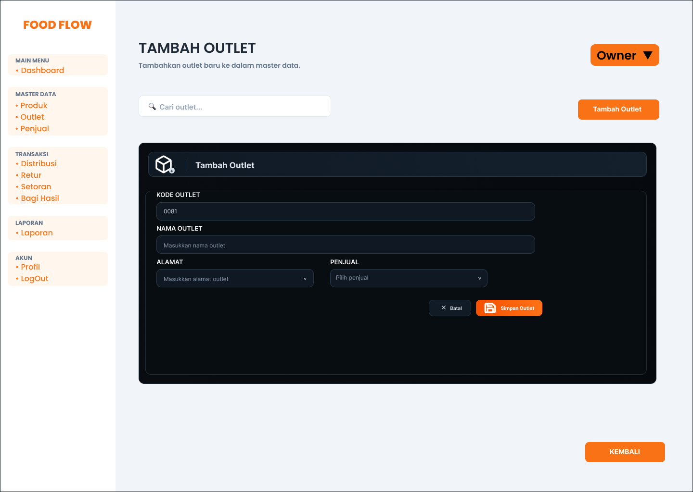 |

| Tambah Penjual | Detail Distribusi |
|:---:|:---:|
| 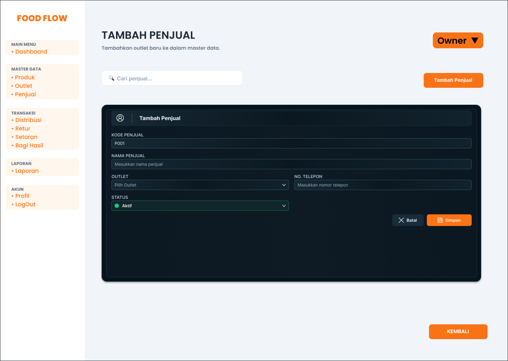 | 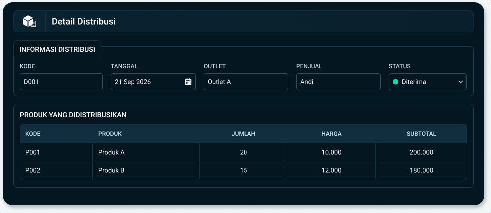 |

## 📊 Pratinjau Dashboard Web FoodFlow

Dashboard Web menyediakan ringkasan penjualan dan visualisasi data berdasarkan informasi yang tersimpan dalam database.

### Summary Cards, Filtering, dan Visualisasi

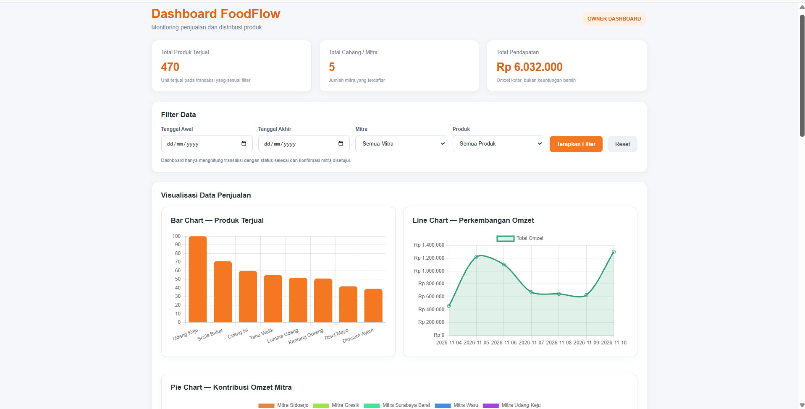

### Pie Chart dan Hasil Data Penjualan

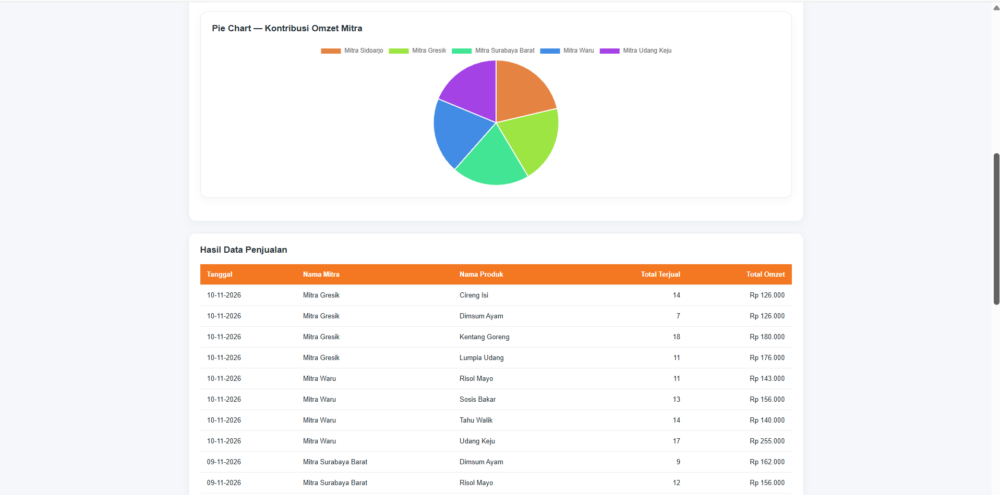

### Ringkasan Data Dashboard

Pada kondisi filter default, dashboard menampilkan:

| Informasi | Hasil |
|---|---:|
| Total Produk Terjual | 470 |
| Total Mitra | 5 |
| Total Pendapatan | Rp6.032.000 |
| Jumlah Produk | 8 |

## 🚀 Cara Menjalankan Projek (Getting Started)

### A. Aplikasi Desktop

#### Prasyarat

Pastikan perangkat sudah memiliki:
1. Flutter SDK.
2. Visual Studio Code.
3. MySQL Server.
4. Dukungan Flutter Desktop untuk Windows.

#### Langkah Instalasi

1. Clone repository:

   ```bash
   git clone https://github.com/sergiobennett/food-flow.git
   ```

2. Masuk ke direktori proyek:

   ```bash
   cd food-flow
   ```

3. Instal dependensi Flutter:

   ```bash
   flutter pub get
   ```

4. Pastikan konfigurasi database dan backend sudah sesuai.
5. Jalankan aplikasi desktop:

   ```bash
   flutter run -d windows
   ```

### B. Dashboard Web

#### Prasyarat

1. XAMPP.
2. PHP.
3. MySQL / MariaDB.
4. Browser.

#### Langkah Instalasi

1. Salin folder `foodflow_dashboard` ke direktori:

   ```text
   C:\xampp\htdocs\
   ```

2. Jalankan Apache dan MySQL melalui XAMPP Control Panel.
3. Buka phpMyAdmin:

   ```text
   http://localhost/phpmyadmin
   ```

4. Siapkan database bernama `foodflow_latest`.
5. Impor dump SQL database terbaru yang disediakan oleh tim.
6. Sesuaikan konfigurasi host, username, password, dan nama database pada file `koneksi.php`.
7. Buka dashboard melalui browser:

   ```text
   http://localhost/foodflow_dashboard/dashboard.php
   ```

## 🗄️ Struktur Database Dashboard

Dashboard Web menggunakan database `foodflow_latest` dengan tabel utama:

- akun_pengguna
- mitra
- produk
- distribusi
- detail_distribusi
- setoran
- bagi_hasil

Database juga menyediakan view `view_nota_distribusi`.

Dashboard menghitung transaksi dengan ketentuan:
- `status_transaksi = 'selesai'`
- `status_konfirmasi_mitra = 'disetujui'`

Summary Card jumlah mitra menghitung seluruh mitra yang terdaftar pada tabel `mitra`.

## 👥 Tim Pengembang

### 1. Sergio Bennett
- NIM: 25082010202
- Program Studi: Sistem Informasi – UPN "Veteran" Jawa Timur
- Peran: Hacker

### 2. Naila Izzah Kusumah
- NIM: 25082010211
- Program Studi: Sistem Informasi – UPN "Veteran" Jawa Timur
- Peran: Hipster

### 3. Bilovi Princessa K.
- NIM: 25082010217
- Program Studi: Sistem Informasi – UPN "Veteran" Jawa Timur
- Peran: Hustler

### 4. Yowin Timothy Napitupulu
- NIM: 25082010226
- Program Studi: Sistem Informasi – UPN "Veteran" Jawa Timur
- Peran: Leader

---

**Food Flow – Sistem Informasi Manajemen Penjualan Konsinyasi untuk UMKM Kuliner.**